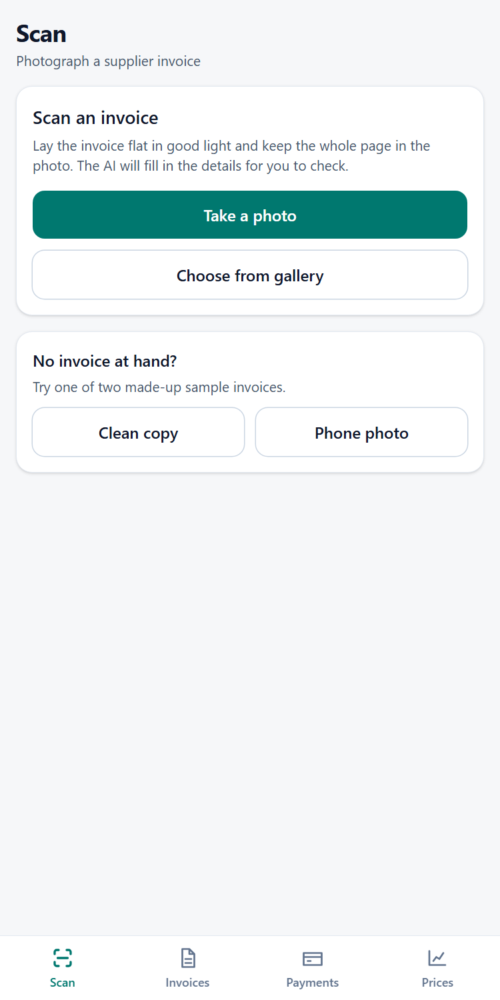
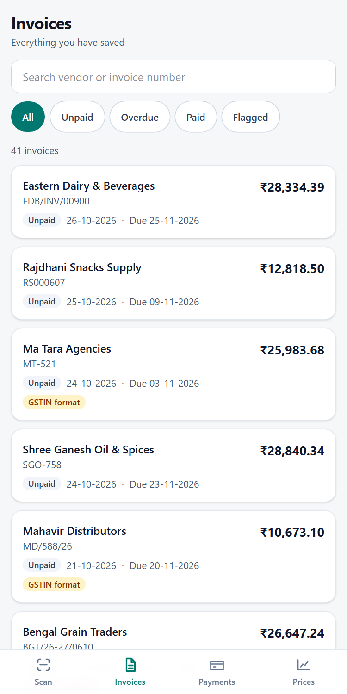
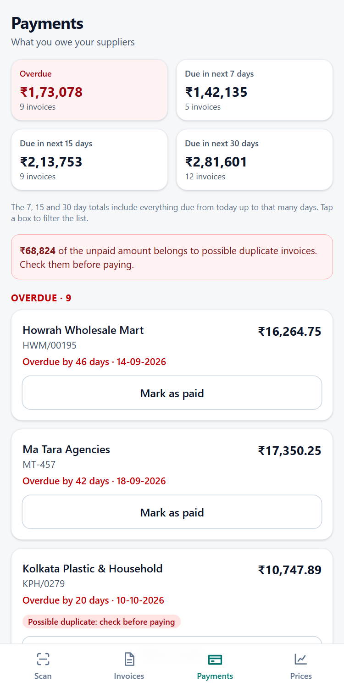
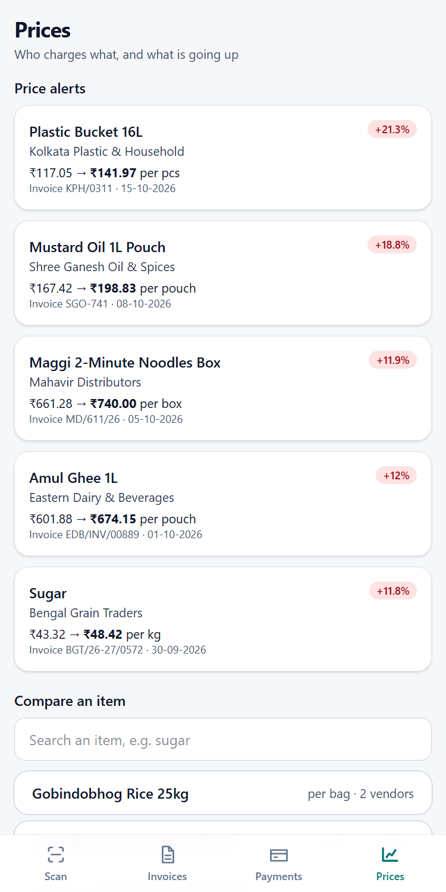
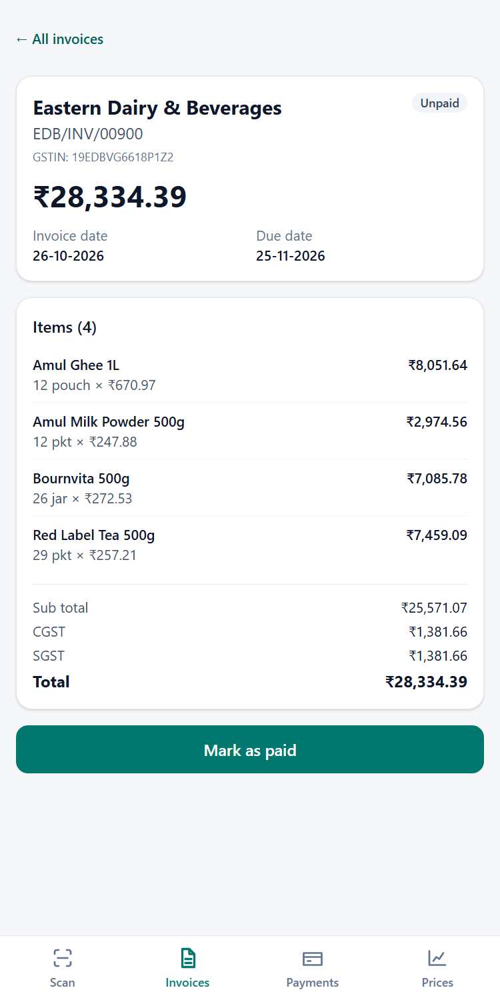
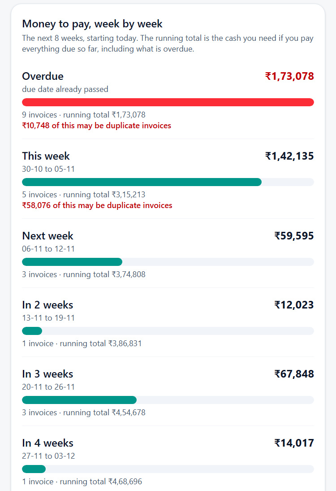
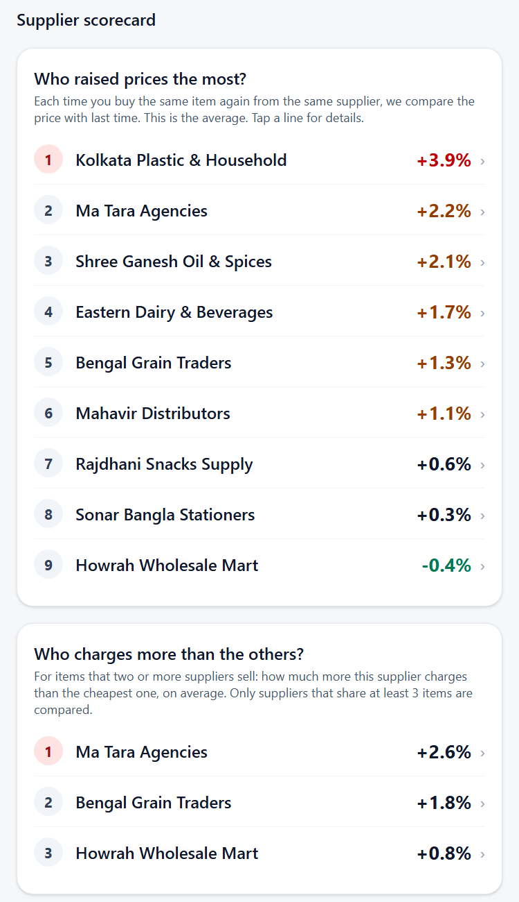

# Smart Invoice Tracker

A mobile-friendly web app for small Indian retailers and distributors. Take a photo of a supplier
invoice, let AI read it, check the fields, and save. The app then tells you **what to pay and when**,
**which invoices look like duplicates**, and **which supplier raised a price**.

**Live demo:** https://smart-invoice-tracker-one.vercel.app
(open it on a phone and choose "Add to Home screen" to install it like an app)

> The demo runs on **made-up data only**. It has no login and everyone shares one demo database, so
> the numbers may have changed since the screenshots. Please do not upload real invoices.

<p>
  
  
  
  
  
</p>

Newer parts: week-by-week cash flow on the Payments tab, and the supplier scorecard on the Prices tab.

<p>
  
  
</p>

## The problem

In many small shops, staff re-type paper supplier invoices into Excel. That causes typing mistakes,
the same invoice paid twice, forgotten due dates, and no view of how supplier prices move.

## What it does

| Screen | What you get |
|---|---|
| **Scan** | Photo of an invoice becomes vendor, GSTIN, invoice number, dates, line items, CGST / SGST / IGST and total. Staff check the fields and press Save. If the AI is not available, or cannot read the paper, the invoice can be typed in by hand with the same checks. An invoice in another currency (for example US dollars) is refused, because the app only handles rupees. |
| **Invoices** | Searchable list with filters: All, Unpaid, Overdue, Paid, Flagged. Open one to see items, taxes, warnings and the original photo. |
| **Payments** | What is overdue and what falls due in the next 7, 15 and 30 days, a week-by-week cash-flow chart for the next 8 weeks (with a running total), and one tap to mark an invoice as paid, with undo. |
| **Prices** | Price alerts, a **supplier scorecard** (who keeps raising prices, who charges more than the others), a vendor-by-vendor comparison for any item, and a price-over-time chart. |

### Automatic flags

| Flag | Rule |
|---|---|
| Possible duplicate | Same vendor and invoice number, or same vendor, amount and date. Saving is stopped until staff confirm. |
| Price jump | An item costs more than 10% above the previous price from the same vendor. Price drops are not flagged. |
| GSTIN format | The vendor GSTIN does not match the 15-character GST pattern. |

## How a scan works

```
phone photo -> browser shrinks it (max 1800 px) -> POST /api/scan
   -> Gemini reads the image (structured JSON, called only from the server)
   -> our own checks re-do the arithmetic, dates, GSTIN and tax logic
   -> staff see the form with warnings and fix anything
   -> POST /api/invoices -> save_invoice() in PostgreSQL (one atomic transaction)
```

The AI output is never trusted. `lib/invoice-checks.ts` re-checks every number, and the same file runs in
the browser (live warnings) and on the server (final check before saving).

## Tech stack

- **Next.js 16** (App Router, React 19, Tailwind CSS 4), installable as a PWA
- **Supabase PostgreSQL** (Mumbai region) with private Storage for invoice photos
- **Google Gemini** vision model through its REST API, with a retry and a fallback model
- **Vercel** hosting, server functions in Mumbai (`bom1`) next to the database
- **Zod** to validate everything the server receives

## The database (the analysis lives in SQL)

All analysis is written as commented SQL views in [`database/04_views.sql`](database/04_views.sql) and
[`database/06_vendor_scorecard_and_cashflow.sql`](database/06_vendor_scorecard_and_cashflow.sql),
so it can be read and reused without the app.

| Object | Purpose |
|---|---|
| `vendors`, `invoices`, `invoice_items` | The three tables ([`01_create_tables.sql`](database/01_create_tables.sql)) with CHECK constraints (for example due date is not before invoice date) |
| `v_flag_duplicates`, `v_flag_bad_gstin`, `v_flag_price_jumps` | One view per flag |
| `v_purchase_lines`, `v_price_history`, `v_price_comparison` | Price analysis: previous price, change %, cheapest vendor |
| `v_all_flags`, `v_invoice_list` | Everything the Invoices screen needs in one query |
| `v_payments_due`, `v_payments_summary` | Overdue and 7 / 15 / 30 day buckets |
| `v_vendor_scorecard` | One row per vendor: average price change on repeat purchases, price level against the cheapest vendor, and a rank. A vendor is only ranked when enough data stands behind the number (5 price changes, or 3 items shared with another vendor) |
| `v_cashflow_weekly` | Unpaid money per week for the next 8 weeks, plus overdue and later, with a running total |
| `save_invoice(p jsonb)` | Saves vendor, invoice and items atomically and refuses duplicates ([`05_save_invoice_and_storage.sql`](database/05_save_invoice_and_storage.sql)) |
| `today_ist()` | Today's date in India, because the server clock is UTC |

SQL used on purpose: window functions (`LAG`, `ROW_NUMBER`, `RANK`, running totals), conditional aggregates (`FILTER`), a self-join
with a row comparison, regular expressions, `STRING_AGG`, and views built on top of views. For example, the price-jump rule is
`LAG(unit_price) OVER (PARTITION BY vendor_id, item_key, unit ORDER BY invoice_date)` compared with `* 1.10`.

## Security decisions

- Row Level Security is **on** for all tables with **no policies**: the public key can read and write nothing.
- Only the server, using the secret key, talks to the database. The browser never sees a key.
- All views use `security_invoker = true`; `save_invoice()` can only be run by the server role.
- Photos are stored in a private bucket and opened through links that expire after 10 minutes.
- The server checks file type by content (not file name), caps photo size, and limits scans per minute.
- Search text is cleaned before it reaches the database.

[`docs/TEST_REPORT.md`](docs/TEST_REPORT.md) shows the checks that were run, including attempts to read and
change data with only the public key.

## Tests

```bash
npx tsc --noEmit                       # types
npm run lint                           # lint
node scripts/test-checks.ts            # 27 tests for the invoice checks
node scripts/test-scan.mjs             # AI reads two sample invoices, compared with known answers
node --env-file=.env.local scripts/test-save.mjs   # scan, save, duplicate, photo, mark paid, undo
node scripts/test-api-errors.mjs       # wrong and hostile input on every API route
node scripts/test-analysis.mjs         # the cash-flow weeks and the supplier scorecard add up with the older views
node scripts/test-gemini-errors.ts     # how the app reacts to Gemini limit / busy answers (fake Google, no quota used)
node scripts/test-variety.mjs          # 8 differently styled invoices compared with the right answers (8 AI reads)
node --env-file=.env.local scripts/test-currency.mjs   # a US dollar invoice cannot be saved, a rupee or unclear one can (2 AI reads)
```

The tests that talk to the app need it running (`npm run dev`). Every AI read counts against the Gemini key's free
daily limit, so run `test-scan`, `test-save`, `test-currency` and `test-variety` sparingly.

## Run it yourself

You need Node.js 24 or newer, a free Supabase project, and a Gemini API key.

1. `npm install`
2. In the Supabase SQL editor run the files in `database/` in order: `01`, `02` (fake data), `04`, `05`, `06`.
   (`03` is a set of check queries.)
3. Copy `.env.example` to `.env.local` and fill in the four values. Use the **secret** key from
   Supabase (Project Settings, API Keys), never the publishable one.
4. `npm run dev` and open http://localhost:3000

To deploy, import the repository into Vercel, add the same four environment variables, and deploy.
`vercel.json` pins the server region to Mumbai.

## Project layout

```
app/            pages (scan, invoices, payments, prices) and API routes (app/api)
components/     the four screens, bottom navigation, price chart, supplier scorecard, cash-flow chart
lib/            Gemini client, invoice checks, validation, formatting, server helpers
database/       SQL: tables, fake data, views, save function
scripts/        tests
docs/           test report and screenshots
test-invoices/  made-up invoice images with the expected answers (two originals, and variety/ with eight styles)
```

## Known limits and next steps

- **No login.** Fine for a demo with fake data; add Supabase Auth before using real data.
- The scan rate limit is kept in each server instance's memory, so it is a guard against accidents
  and cheap abuse, not a hard limit.
- Only paid / unpaid is tracked, no partial payments.
- **Rupees only.** The AI reports the currency it sees. A currency the app is sure about (USD, EUR, AED, `$` ...) blocks
  Save; an odd or unknown answer only gives a warning, so a real rupee invoice is never locked out by a guess. An invoice
  with no currency sign at all is treated as rupees, so a foreign invoice with plain numbers would get through.
- Credit notes and discount lines with negative amounts are not supported; the screen says so before Save.
- Fields the AI cannot find: a missing unit becomes "pcs" and a missing invoice number becomes a `NO-NUMBER-date-total`
  reference, both with a warning. A missing vendor name, invoice date, total, or an item's name, quantity or price
  must be typed before saving. Missing GSTIN, due date, taxes and sub total are only warnings.
- The AI was tested on made-up invoices only, not on real, handwritten or blurred shop bills.
- **The free Gemini key allows only about 20 photo reads per day per model.** The live demo shares that limit
  between all visitors. When it is used up, the Scan screen says so and invoices can still be typed in by hand.
  For real use, use a paid key.
- The supplier scorecard compares prices by cleaned item name, so "Sugar 1kg" and "Sugar (1 kg)" are two items.
  It does not adjust for inflation or convert units.
- Not built yet: matching the invoices against the GST portal's GSTR-2B file (input tax credit at risk).
- One shop only; a multi-shop version would add a `shop_id` and Row Level Security policies.
